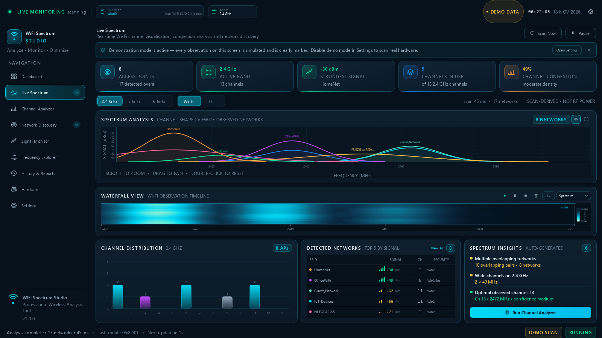

# WiFi Spectrum Studio

Professional desktop analysis for Wi-Fi environments: live channel occupancy, a
waterfall timeline, per-channel interference scoring, network discovery,
signal tracking, history and exportable reports.



WiFi Spectrum Studio is a PySide6 application for Linux (Parrot OS, Debian,
Ubuntu, Kali) and Windows. It reads real scan data from the operating system's
wireless stack, keeps a local SQLite history, and presents everything in a
dark, instrument-style interface.

---

## About

**WiFi Spectrum Studio** is a professional, open-source desktop application for
analysing Wi-Fi environments: live spectrum monitoring, channel planning, waterfall
visualisation, interference scoring and signal intelligence.

- **Stack:** Python 3.12+, PySide6, pyqtgraph, NumPy, SQLite.
- **Pages:** Dashboard, Live Spectrum, Channel Analyzer, Network Discovery, Signal
  Monitor, Frequency Explorer, History & Reports, Hardware, Settings (nine pages,
  Live Spectrum default).
- **Sources:** `iw` / NetworkManager on Linux, `netsh` on Windows; optional SoapySDR for
  true FFT traces; built-in Demo Backend with clearly labelled simulated data.
- **Honesty:** Wi-Fi curves and waterfalls are channel-shaped visualisations derived
  from scan observations, not FFT measurements; interference is a relative overlap
  index (1.00 = busiest channel in band); no fabricated measurement data.

---

## What this application does — and does not — measure

Being precise about data provenance matters more than a pretty graph.

| Layer | Source | Honest description |
| --- | --- | --- |
| Access points, SSID, BSSID, channel, width, RSSI, security | `iw` / `nmcli` (Linux), `netsh wlan` (Windows) | Real observations reported by the adapter and driver |
| Spectrum curves | Derived from observed channel, width and RSSI | **Channel-shaped visualisation**, not an FFT power spectrum |
| Waterfall | Same scan observations, one row per scan | Observation timeline, not RF energy |
| Channel interference score | Weighted spectral overlap of observed networks | A comparative index (1.00 = busiest channel in that band), not airtime utilisation |
| True FFT traces | SoapySDR device, when installed | Only shown when an SDR is actually present |
| Demonstration mode | Built-in simulator | Clearly labelled as simulated in the top bar, notice bar and status bar |

There is no fabricated measurement data. When the application does not know
something it shows an empty state rather than inventing a number.

---

## Feature tour

| Page | Purpose |
| --- | --- |
| **Dashboard** | One-screen health summary: totals, band density, RSSI distribution, monitoring state and recent scans |
| **Live Spectrum** | Signature page — metric cards, band tabs, channel-shaped spectrum, waterfall, channel distribution, top networks and generated insights |
| **Channel Analyzer** | Scores every channel, recommends the quietest option with confidence, and lists overlapping networks |
| **Network Discovery** | Searchable, sortable table of every observed access point with BSSID, vendor, band and security filters |
| **Signal Monitor** | Tracks individual networks over time, with RSSI chart, min/avg/max, stability and CSV export |
| **Frequency Explorer** | Channel map across 2.4/5/6 GHz, band summary and an observed-frequency table |
| **History & Reports** | Browse stored scans, inspect captured networks, export HTML/CSV/JSON/PDF reports |
| **Hardware** | Adapter capabilities, driver details, SDR/FFT status, diagnostics and log paths |
| **Settings** | Scan interval, palette, region, retention, export directory, demo mode and SDR configuration |

Keyboard shortcuts: `Ctrl+1` … `Ctrl+9` switch pages, `Ctrl+F` focuses the
search field on Discovery, `Ctrl+R` or `F5` starts a scan, `Ctrl+,` opens
Settings and `Esc` closes the inspection drawer.

---

## Requirements

- Python **3.12+** (developed and tested on 3.13)
- PySide6 ≥ 6.6, pyqtgraph ≥ 0.13.3, NumPy ≥ 1.26
- Linux: `iw` and NetworkManager (`nmcli` is used as a fallback)
- Optional: SoapySDR + a supported SDR for true FFT traces

SciPy is **not** required.

## Quick start

### Linux (Parrot OS / Debian / Ubuntu)

```bash
sudo apt install python3 python3-venv python3-pip iw network-manager \
    python3-pyside6.qtwidgets python3-pyqtgraph python3-numpy

git clone <repository> wifi-spectrum-studio
cd wifi-spectrum-studio
python3 -m venv .venv
source .venv/bin/activate
pip install -r requirements.txt
python run.py
```

### Windows

```powershell
py -3.12 -m venv .venv
.\.venv\Scripts\Activate.ps1
pip install -r requirements.txt
python run.py
```

Windows scans use `netsh wlan show networks mode=bssid`; RSSI is derived from
the reported signal percentage using the standard `(pct / 2) - 100` mapping and
is labelled as an estimate.

See [docs/INSTALL.md](docs/INSTALL.md) for permissions, packaging and
troubleshooting, and [docs/USER_GUIDE.md](docs/USER_GUIDE.md) for a page-by-page
walkthrough.

---

## Demonstration mode

Without a wireless adapter (or when you enable **Settings → Demonstration
mode**), the application runs against a deterministic simulator with 17 access
points across all three bands. Demo data is never presented as measurement:

- a yellow **DEMO DATA** pill appears in the top bar;
- a notice bar explains that observations are simulated;
- the status bar shows **DEMO SCAN**;
- the Hardware page marks the adapter and data source as simulated.

Switch demo mode off in Settings to return to hardware scans.

---

## Project layout

```
wifispectrum/
  core/           constants, bands, channels, models, events, platform helpers
  services/       scan, backends (linux/windows/demo), monitor, analysis,
                  spectrum, waterfall, signal, history, report, SDR, settings
  ui/             theme, icons, widgets, pages, main window
  workers/        background task primitives
tools/
  screenshot.py   offscreen render harness used for visual QA
tests/            channel maths, models, parsers, spectrum geometry
packaging/        .desktop file, Debian control file, build script
assets/           application icon (SVG)
docs/             installation and user guide
```

All long-running work (scans, reports, exports, adapter detection) runs in
background workers so the interface never blocks.

## Development

```bash
python -m pytest -q                      # unit tests
python -m compileall -q wifispectrum     # syntax check
python tools/screenshot.py spectrum dashboard analyzer discovery signal \
    frequency history hardware settings  # render every page offscreen
python tools/screenshot.py --size=1280x780 spectrum analyzer  # small-window check
```

Screenshots are written to `artifacts/` at 1600×900. The harness forces demo
mode and loads system fonts so offscreen rendering matches the real UI.

## Building a Debian package

```bash
bash packaging/build_deb.sh
sudo dpkg -i dist/wifispectrum_1.0.0_all.deb
```

The package installs the application under `/usr/lib/wifispectrum`, adds a
launcher at `/usr/bin/wifispectrum` and registers a desktop entry and icon.

## License

Released under the MIT license. See [LICENSE](LICENSE).
